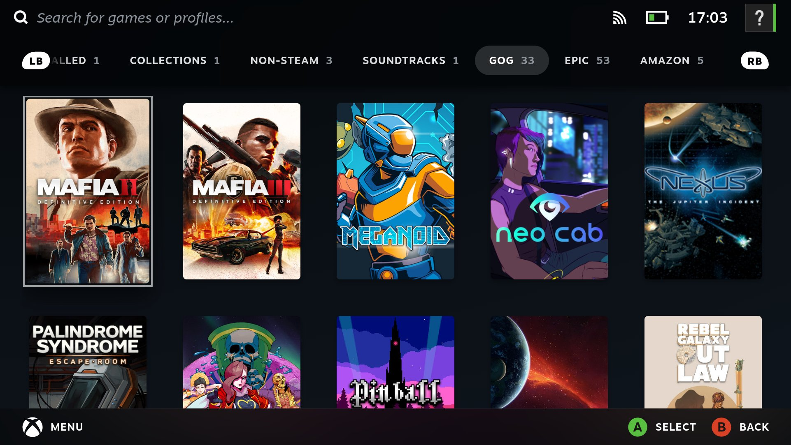
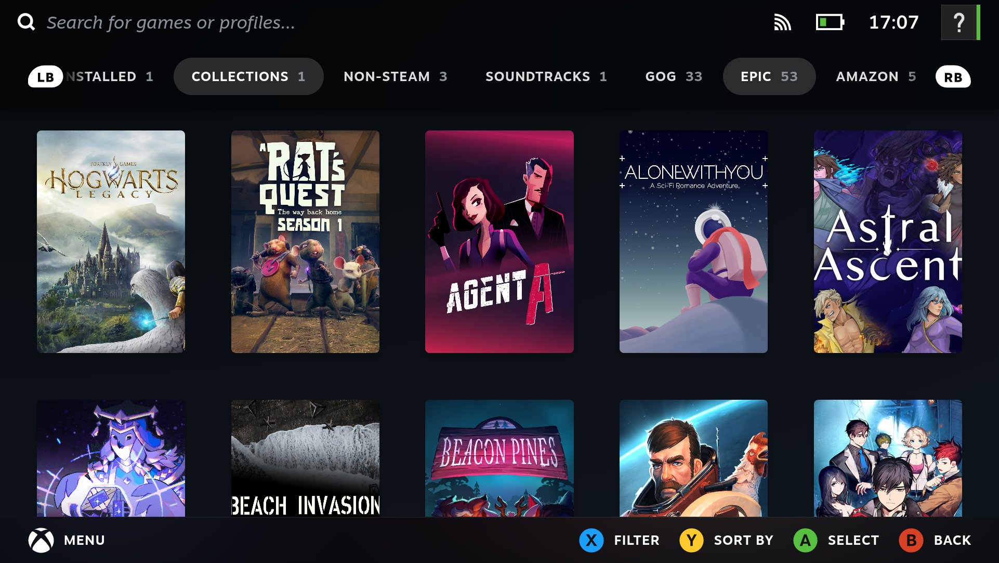
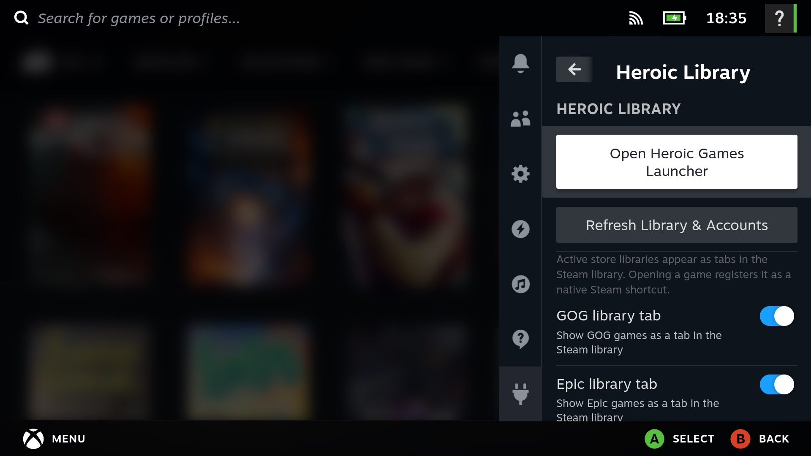

# Heroic Library

[](https://github.com/fmenezes/decky-heroic/releases/latest)
[](LICENSE)
[](https://github.com/SteamDeckHomebrew/decky-loader)

Your GOG, Epic, Amazon, and sideloaded games — seamlessly integrated as native tabs in your Steam library on Steam Deck, Bazzite, and ROG Ally / Legion Go.

| GOG Library Tab | Epic Games Library Tab |
| :---: | :---: |
|  |  |

This [Decky Loader](https://github.com/SteamDeckHomebrew/decky-loader) plugin adds a dedicated tab per store directly to Steam's main library. Open any game from a tab and it becomes an official Steam shortcut on the spot: its native game page opens, with full Steam overlay support, custom controller configurations, and playtime tracking. Heroic handles the background launch protocol, keeping cloud saves perfectly in sync.

Heroic itself gets a Steam shortcut too (with high-res custom box art) with a single click in the plugin settings.

---

## Features

- **Native Steam Look & Feel**: Uses Steam Big Picture's exact responsive grid sizing (5 columns on handheld, 7 columns docked), poster aspect ratios, and gamepad focus zoom animations.
- **On-Demand Shortcuts**: Only creates non-Steam shortcuts when you actually select a game — keeping your `shortcuts.vdf` clean instead of bloating it with hundreds of uninstalled titles.
- **Cloud Saves & Protocol Launching**: Uses `heroic://launch` protocol actions so Heroic's native cloud sync, install dialogs, and runner settings work out of the box.
- **Heroic Settings Inspector**: Automatically checks your Heroic configuration and warns you in the Quick Access panel if any settings could cause duplicate shortcuts or unwanted pop-ups in Game Mode.
- **Zero Background Daemons**: Reads Heroic's cached store files directly without scraping, CLI overhead, or persistent background memory drain.

---

## Installing

Grab the latest [`decky-heroic.zip`](https://github.com/fmenezes/decky-heroic/releases/latest) and install it via **Decky → Developer → Install plugin from URL/file**, or via terminal:

```bash
sudo decky-plugin-cli install https://github.com/fmenezes/decky-heroic/releases/latest/download/decky-heroic.zip
```

**Prerequisites**:
- [Decky Loader](https://github.com/SteamDeckHomebrew/decky-loader)
- [Heroic Games Launcher](https://heroicgameslauncher.com/) (Flatpak or Native) logged into your GOG, Epic, or Amazon account.

---

## Settings

In the plugin's Quick Access panel, you can:
- Toggle individual store tabs (`GOG`, `Epic`, `Amazon`, `Sideloaded`) on or off.
- Launch Heroic Games Launcher directly.
- View Heroic configuration health warnings and recommendations.
- Force refresh store libraries and login status.



---

## How It Works

No heavy scraping or fragile screen hooks: the plugin reads Heroic's local store cache files, injects reactive tabs into Steam's library tab bar (leveraging the technique pioneered by [TabMaster](https://github.com/Tormak9970/TabMaster)), and registers games as shortcuts through Steam's internal client API on first click.

---

## Contributing

Contributions are welcome! See [CONTRIBUTING.md](CONTRIBUTING.md) for local development setup, testing, and release workflows.

---

## Special Thanks & Acknowledgements

- **[gomi](https://www.steamgriddb.com/profile/76561198068865979)** on **[SteamGridDB](https://www.steamgriddb.com/)** for the Heroic Games Launcher artwork set:
  - [Vertical Grid](https://www.steamgriddb.com/grid/311139)
  - [Wide Banner](https://www.steamgriddb.com/grid/311138)
  - [Hero Background](https://www.steamgriddb.com/hero/74663)
  - [Logo](https://www.steamgriddb.com/logo/78805)
  - [Icon](https://www.steamgriddb.com/icon/33171)
- **[Heroic Games Launcher](https://heroicgameslauncher.com/)** team for the open-source client.
- **[Decky Loader](https://github.com/SteamDeckHomebrew/decky-loader)** team for the handheld plugin environment.
- **[TabMaster](https://github.com/Tormak9970/TabMaster)** (by Tormak9970) for pioneering library tab injection in Steam Big Picture.

*Disclaimer: All game titles, covers, and logos remain the copyright of their respective publishers and platform holders (GOG, Epic Games, Amazon).*

---

## License

[MIT](LICENSE)
